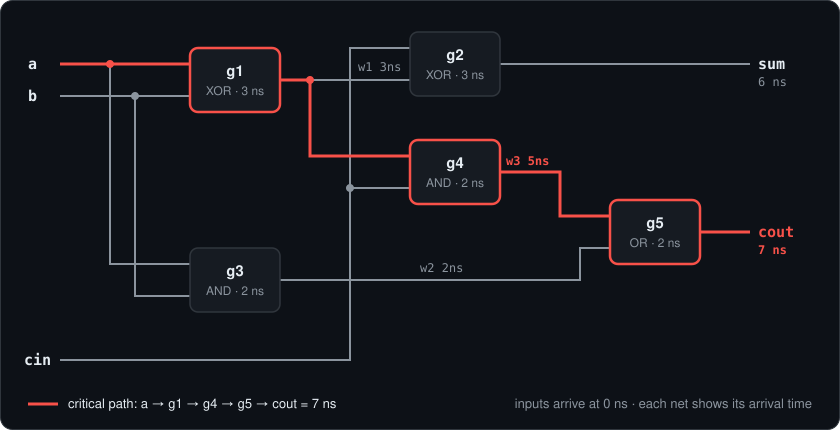
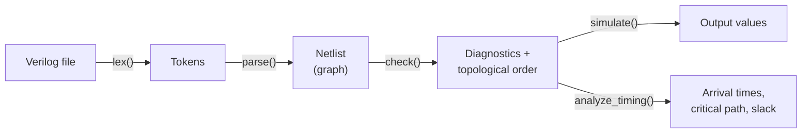

<p align="center">
  
</p>

<h1 align="center">gatesim</h1>

<p align="center">
  <b>Check, simulate and time gate-level Verilog circuits.</b><br>
  A small electronic design automation (EDA) tool, written from scratch in C++20.
</p>

<p align="center">
  <a href="https://github.com/saif-hmaied/gatesim/actions/workflows/ci.yml"></a>
  
  
  
</p>

<p align="center">
  
</p>

## Overview

Digital chips are built from **logic gates** (AND, OR, XOR, ...) connected by
**wires**. A *gate-level netlist* is the text file that lists these gates and
how they are connected. Before a design goes to manufacturing, engineers need
answers to three questions:

1. **Is the circuit well-formed?** No wire driven by two gates, no input left
   floating, no feedback loop.
2. **What does it compute?** The output values for given input values.
3. **Is it fast enough?** How long signals take to cross the circuit, compared
   with the clock period.

Industrial EDA tools answer these questions for designs with billions of gates.
**gatesim answers them for small netlists, with every step implemented by
hand**: a lexer, a recursive-descent parser, a graph-based netlist, design
checks with cycle detection, logic simulation and static timing analysis. It
uses only the C++ standard library.

| Command | Question | Result |
|---|---|---|
| `gatesim check` | Is the circuit well-formed? | every design error and warning, in one run |
| `gatesim sim` | What does it compute? | output values, or the full truth table |
| `gatesim timing` | Is it fast enough? | arrival times, critical path and slack |

## Contents

- [Quick start](#quick-start)
- [Example circuit](#example-circuit)
- [Usage](#usage)
- [Supported Verilog](#supported-verilog)
- [How it works](#how-it-works)
- [Limitations and roadmap](#limitations-and-roadmap)
- [Project layout](#project-layout)

## Quick start

Requirements: a C++20 compiler (CI builds with GCC and Clang on Ubuntu 24.04),
CMake 3.20 or newer, and optionally Ninja.

```bash
git clone https://github.com/saif-hmaied/gatesim.git
cd gatesim
cmake -S . -B build -G Ninja -DCMAKE_BUILD_TYPE=Release
cmake --build build
./build/gatesim timing examples/full_adder.v --clock 5
```

## Example circuit

The examples below use a **full adder**: it adds three bits `a`, `b` and `cin`,
and produces a sum bit `sum` and a carry bit `cout`.

<p align="center">
  
</p>

```verilog
module full_adder(a, b, cin, cout, sum);
    input  cin, a, b;
    output cout, sum;
    wire   w1, w2, w3;
    xor g1(w1, a, b);      // type, name, then output net and input nets
    xor g2(sum, cin, w1);
    and g3(w2, a, b);
    and g4(w3, w1, cin);
    or  g5(cout, w3, w2);
endmodule
```

## Usage

```
gatesim check  <file.v>
gatesim sim    <file.v> --input name=0|1 ...
gatesim sim    <file.v> --all
gatesim timing <file.v> [--clock <ns>]
```

### `check`: find design errors

```
$ gatesim check examples/full_adder.v
module full_adder: 5 gates, 8 nets, 0 errors, 0 warnings

$ gatesim check examples/bad_loop.v
examples/bad_loop.v: error: combinational loop: g1 -> w1 -> g2 -> w2 -> g1
module bad_loop: 3 gates, 4 nets, 1 errors, 0 warnings
```

All problems are reported in a single run:

| Problem | Severity |
|---|---|
| net driven by more than one gate | error |
| net that is read (or is an output) but has no driver | error |
| input driven by a gate | error |
| combinational loop (one message per loop) | error |
| net that is never read | warning |

The `examples/` folder contains one netlist for each kind of mistake:

| File | Mistake | gatesim reports |
|---|---|---|
| `bad_loop.v` | `g1` and `g2` feed each other | `combinational loop: g1 -> w1 -> g2 -> w2 -> g1` |
| `bad_multidriver.v` | `y` is driven by two gates | `net 'y' has 2 drivers: g1 g2` |
| `bad_undriven.v` | `w` is read but never driven | `net 'w' has no driver` |
| `bad_syntax.v` | a missing comma | `examples/bad_syntax.v:5:14: error: expected ',' found a` |

Syntax errors stop at the first problem and point to its exact line and column.
The exit code is 1 when there are errors, so gatesim can be used in scripts.

### `sim`: simulate the circuit

```
$ gatesim sim examples/full_adder.v --input a=1 b=0 cin=1
cout = 1
sum = 0

$ gatesim sim examples/full_adder.v --all
a b cin | cout sum
0 0 0   | 0    0
0 0 1   | 0    1
0 1 0   | 0    1
0 1 1   | 1    0
1 0 0   | 0    1
1 0 1   | 1    0
1 1 0   | 1    0
1 1 1   | 1    1
```

The truth table columns follow the port order of the module header.

### `timing`: static timing analysis

```
$ gatesim timing examples/full_adder.v --clock 8
output arrival times:
  cout  7 ns
  sum   6 ns
critical path (7 ns):
  a -> g1 -> w1 -> g4 -> w3 -> g5 -> cout
clock 8 ns, slack 1 ns: OK
```

- **Arrival time** of a net: the time when its value is ready. Inputs arrive at
  0, and a gate's output arrives at `max(arrival of its inputs) + gate delay`.
- **Critical path**: the slowest path from an input to an output. It limits how
  fast the clock can be.
- **Slack** = `clock period - worst arrival`. A negative slack means the circuit
  is too slow for this clock, and the exit code is 1.
- `--clock` is optional. Without it, only the arrival times and the critical
  path are printed.

Gate delays (ns):

| not, buf | nand, nor | and, or | xor, xnor |
|:---:|:---:|:---:|:---:|
| 1 | 1.5 | 2 | 3 |

## Supported Verilog

gatesim reads **gate-level netlists**: one module made of basic gates and the
wires between them.

- `module` / `endmodule`, `input`, `output`, `wire`
- gates: `and`, `or`, `not`, `nand`, `nor`, `xor`, `xnor`, `buf`; the first
  port is the output, and the others are inputs
- `//` comments
- names must be declared before they are used

## How it works



| Stage | What it does | Technique |
|---|---|---|
| **Lexer** | splits the text into tokens and rejects invalid characters, with line and column | one pass; tokens are `std::string_view`s into the source, so no text is copied |
| **Parser** | checks the grammar and builds the netlist in the same pass; reports undeclared names, duplicates and port errors | recursive descent, one function per grammar rule |
| **Netlist** | stores the circuit as a graph: each gate knows its nets, each net knows its drivers and readers | integer IDs into `std::vector`s instead of pointers |
| **Check** | applies the rules to every net, then orders the gates | Kahn's algorithm for the topological order; Kosaraju's algorithm (strongly connected components) to report each loop separately |
| **Simulation** | computes the value of every net | one pass over the gates in topological order |
| **Timing** | computes arrival times and the critical path | longest path in a DAG by dynamic programming, then a walk back from the latest output |

### Design decisions

- **Integer IDs instead of pointers.** Gates and nets live in two
  `std::vector`s and refer to each other by index. IDs stay valid when a vector
  grows, take 4 bytes instead of 8, and make per-net data simple: simulation
  values and arrival times are side arrays indexed by net ID.
- **Syntax errors stop, design errors accumulate.** After a syntax error the
  parser cannot know what the rest of the file means, so it reports the first
  one. Design problems are independent, so `check` reports all of them at once.
- **Linear time.** Every stage runs in O(gates + connections).

## Limitations and roadmap

Current limitations:

- One flat module: no hierarchy, no buses (`wire [3:0]`), no `assign`.
- Combinational circuits only: no flip-flops.
- Timing uses a fixed delay per gate type, and wire delay is 0. Real tools use
  delays that depend on the load and on wire length.
- Loop detection is recursive, so a very long chain of gates could overflow the
  stack.

Next ideas:

- [ ] Bit-parallel simulation: 64 input patterns at once with `uint64_t`
- [ ] Gate delays read from a file
- [ ] Graphviz export, with the critical path highlighted
- [ ] Sequential circuits (flip-flops and a clock)

## Project layout

```
include/gatesim/   headers: token, lexer, netlist, parser, check, simulator, timing
src/               library implementation
apps/              command-line tool
examples/          example netlists, including bad_*.v circuits with known errors
assets/            logo, demo animation and diagrams
```

---

<p align="center">Built by <a href="https://github.com/saif-hmaied">Saif Hmaied</a></p>
